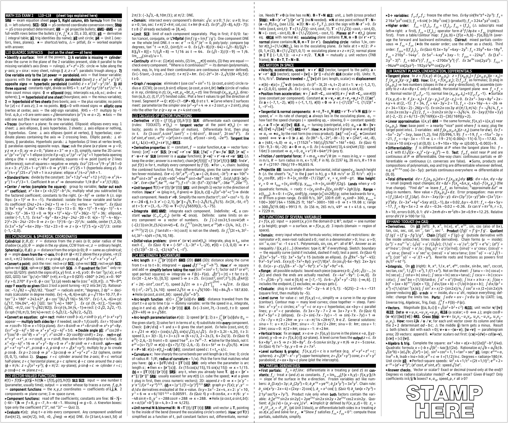

# Exam notecard playbook

For Claude agents asked to build a printed exam notecard. It records how the Math 215 Exam 2 card was made on 2026-10-27, what went wrong, and what to do next time. The user called that card "beautiful" and, afterward, a "big success".

## Start here

1. Follow [docs/workflow.md](docs/workflow.md) in order.
2. Copy `template/notecard.tex` and `template/letter-sheet.tex` into the user's notecard folder as `UnitN_Notecard_6x5.tex` and `UnitN_Notecard_Letter.tex`. Point `\cardpdf` in the sheet at the new card PDF.
3. Check [docs/gotchas.md](docs/gotchas.md) when anything looks wrong.

## The spec that worked

| Item | Value |
|---|---|
| Deliverables | `UnitN_Notecard_6x5.pdf`, `UnitN_Notecard_Letter.pdf`, and both `.tex` sources, in the user's notecard folder |
| Sheet | One 6 × 5 in page, 4 columns, dashed center line. Each half is one face of a 3 × 5 card |
| Body type | Bell Centennial Std Address, `\fontsize{3.55}{3.774}` |
| Math | Fira Math at `Scale=0.92`, slashed fractions, prefix radicals |
| Marker glyphs | DejaVu Sans for ▸ ⚠ ★ |
| Stamp area | Hollow "STAMP HERE" at the bottom of column 4 |
| Engine | Tectonic 0.17.0 (XeTeX), installed with Homebrew |
| Capacity | About 25,000 characters on the sheet, against about 16,000 on the Unit 1 card |

## Rules that would have saved the most time

1. **Never use stacked fractions or `\sqrt`.** Write `x^2/a^2` and `\rt(x^2+y^2)` from the first draft. Converting 207 fractions and 85 radicals afterward was the biggest rework of the build.
2. **Compile final PDFs in place, then `ls` them before linking.** The one failure the user actually hit: the letter sheet was built and verified in the scratchpad, never copied to their folder, and linked anyway.
3. **Build the stamp block and letter sheet from the start.** The user asked for both at the end, and will want them again.
4. **Recompute every worked example.** A wrong example on a card is worse than none, and the user can't check it mid-exam.
5. **Keep anything worth saving outside the scratchpad.** It was empty when the session resumed, and the fraction converter had to be rebuilt.

## What's here

| Path | Contents |
|---|---|
| [docs/workflow.md](docs/workflow.md) | The build, step by step, with commands |
| [docs/content.md](docs/content.md) | What the user asked for, how entries are structured, how to mine sources |
| [docs/typesetting.md](docs/typesetting.md) | Geometry, fonts, spacing, macros, and the measurements behind them |
| [docs/gotchas.md](docs/gotchas.md) | Every failure so far: symptom, cause, fix |
| [docs/equation-sheet-map.md](docs/equation-sheet-map.md) | Tag-by-tag map of the Math 215 sheet, including Units 3 and 4 |
| `template/` | Working card and letter-sheet sources: preamble as shipped, a sample entry, the reusable toolkit, the stamp block |
| `tools/` | `card_stats.py`, `fit_size.sh`, `proof_tiles.sh`, `defrac.py` |
| `examples/unit2/` | The shipped card: sources, PDFs, preview |

The example `.tex` differs from the shipped file only in using an absolute path for the Bell font, so it builds from a clone. Its rebuilt text matches the shipped PDF.

## Not in this repo

- **Commercial fonts.** Bell Centennial and Helvetica 95 Black are in `~/Library/Fonts/` on the user's Mac. `.gitignore` blocks font files.
- **Course materials.** The lesson PDFs, quizzes, and equation sheet stay in the user's notecard folder. The Unit 2 set is in `~/Documents/BYUI Assignments/Semester 7/Calc exam 2 notecard/`, along with the Unit 1 card.

## Print result

The user's report on the printed Unit 2 card: the text "was great", with "room to spare on font sizing". In their words, "We're not even pushing the boundaries yet." So 3.55 pt is comfortable, not a floor. If a future card runs over, shrink the type before cutting content.

## Still unknown

- The smallest size the user can read. No agent has seen a printed card, so any floor has to come from them.
- Which print settings were used. Ask, and record the answer here.
- Whether a non-CAS calculator is allowed. The Unit 2 card assumes one might be and also gives exact-value methods.

## Keeping this current

After each new card, add its measurements and any new failures to the docs, and add it under `examples/`. Mark anything untested as untested.
