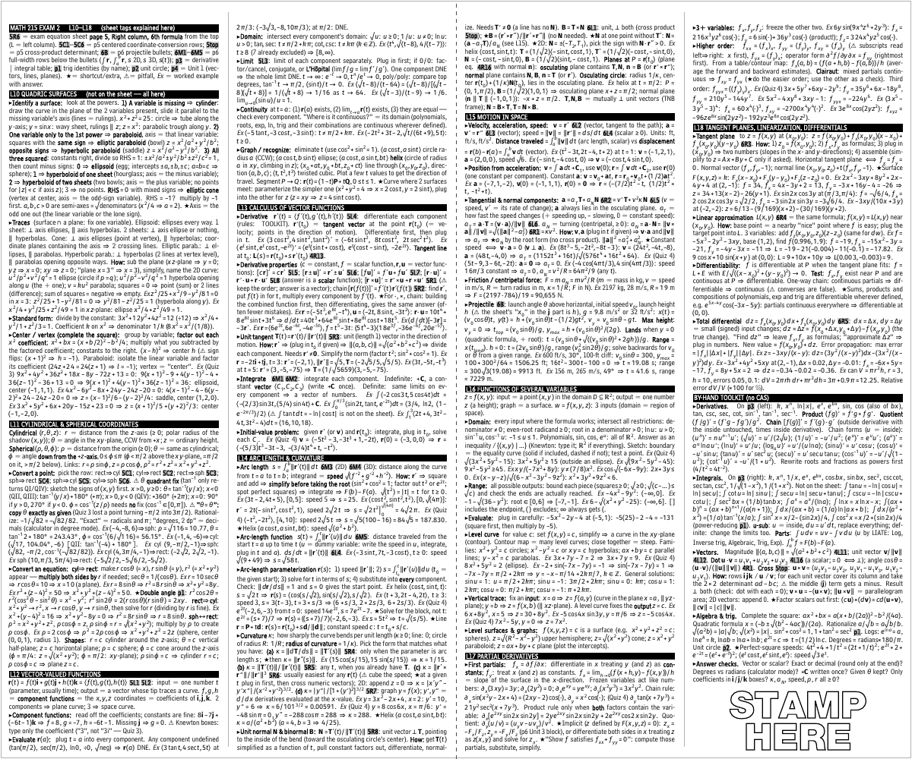
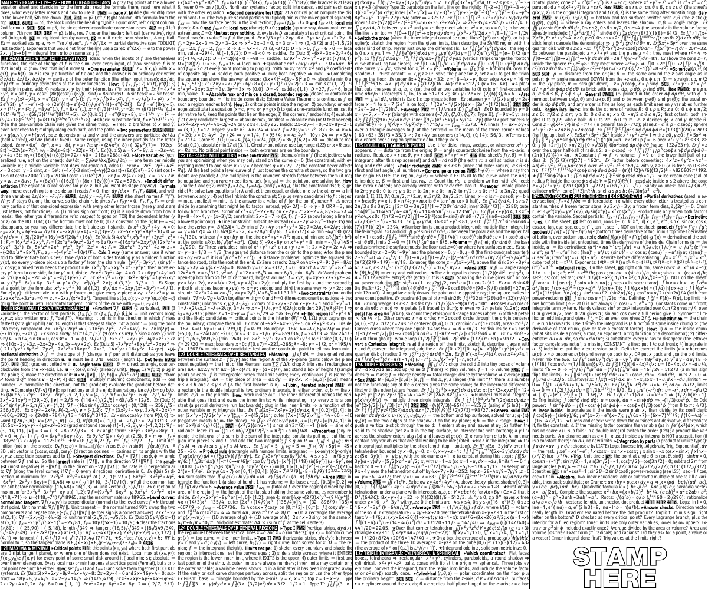

# Exam notecard playbook

For Claude agents asked to build a printed exam notecard. It records how the Math 215 Exam 2 card was made on 2026-10-27 and the Exam 3 card on 2026-11-16, what went wrong, and what to do next time. The user called the Exam 2 card "beautiful" and, afterward, a "big success", then asked for the Exam 3 card to be denser still.

## Start here

1. Follow [docs/workflow.md](docs/workflow.md) in order.
2. Copy `template/notecard-solid.tex` and `template/letter-sheet.tex` into the user's notecard folder as `UnitN_Notecard_6x5.tex` and `UnitN_Notecard_Letter.tex`. Point `\cardpdf` in the sheet at the new card PDF. `notecard-solid.tex` is the current layout (zero margins, lines set solid). `template/notecard.tex` is the roomier Unit 2 layout, kept in case the user wants it back.
3. Check [docs/gotchas.md](docs/gotchas.md) when anything looks wrong.

## The spec that worked

| Item | Unit 2 (2026-10-27) | Unit 3 (2026-11-16), current |
|---|---|---|
| Deliverables | `UnitN_Notecard_6x5.pdf`, `UnitN_Notecard_Letter.pdf`, and both `.tex` sources, in the user's notecard folder | Same |
| Sheet | One 6 × 5 in page, 4 columns, dashed center line. Each half is one face of a 3 × 5 card | Same, with a solid center line. Optional duplex sheet as well |
| Margins and gaps | 0.06 in margins, 0.12 in between columns | No margins. 1.4 pt between columns with a solid hairline rule |
| Body type | Bell Centennial Std Address, `\fontsize{3.55}{3.774}` | Same face, 3.3 pt on a 3.129 pt pitch: 115 lines per column, set solid |
| Math | Fira Math at `Scale=0.92`, slashed fractions, prefix radicals | Same, plus scripts held inside the line, and a caret for nested exponents |
| Entries | One paragraph per problem type | Run-in: only lesson headers start a line |
| Sheet formulas | Short ones typed out beside their tag | Tag instead of the formula, with every letter explained |
| Marker glyphs | DejaVu Sans for ▸ ⚠ ★ | Same, plus ✓ |
| Stamp area | Hollow "STAMP HERE" at the bottom of column 4 | Same, 9 lines tall |
| Engine | Tectonic 0.17.0 (XeTeX), installed with Homebrew | Same |
| Capacity | 25,367 characters, against about 16,000 on the Unit 1 card | 40,736 characters |

## Rules that would have saved the most time

1. **Never use stacked fractions or `\sqrt`.** Write `x^2/a^2` and `\rt(x^2+y^2)` from the first draft. Converting 207 fractions and 85 radicals afterward was the biggest rework of the build.
2. **Compile final PDFs in place, then `ls` them before linking.** The one failure the user actually hit: the letter sheet was built and verified in the scratchpad, never copied to their folder, and linked anyway.
3. **Build the stamp block and letter sheet from the start.** The user asked for both at the end, and will want them again.
4. **Recompute every worked example.** A wrong example on a card is worse than none, and the user can't check it mid-exam.
5. **Keep anything worth saving outside the scratchpad.** It was empty when the session resumed, and the fraction converter had to be rebuilt.

From the Unit 3 card:

6. **Start from `template/notecard-solid.tex`.** Its script, integral and bracket macros took a third of the build to get right. TeX's own script positions collide once lines are set solid.
7. **One script per base, none inside another, no powers or roots in stacked limits.** `tools/check_scripts.py` finds all three. None is a TeX error, and each prints as a smudge.
8. **Watch column 4 after every edit.** Nothing in the solid layout can shrink, so an overfull card puts the stamp on top of the text instead of starting a second page.
9. **Solve the examples before writing them down.** The lesson PDFs were guided notes with blank examples. One sympy script covered all of them, and a second agent re-derived the finished card. It found no wrong numbers, and five statements that needed a condition or a clearer wording.
10. **A tag replaces the formula.** The space saved pays for saying what every letter on the sheet means, which is what the user asked for.

## What's here

| Path | Contents |
|---|---|
| [docs/workflow.md](docs/workflow.md) | The build, step by step, with commands |
| [docs/content.md](docs/content.md) | What the user asked for, how entries are structured, how to mine sources |
| [docs/typesetting.md](docs/typesetting.md) | Geometry, fonts, spacing, macros, and the measurements behind them |
| [docs/gotchas.md](docs/gotchas.md) | Every failure so far: symptom, cause, fix |
| [docs/equation-sheet-map.md](docs/equation-sheet-map.md) | Tag-by-tag map of the Math 215 sheet, including Units 3 and 4 |
| `template/` | `notecard-solid.tex` (current layout), `notecard.tex` (Unit 2 layout), `letter-sheet.tex`: preamble as shipped, sample entries, the reusable toolkit, the stamp block |
| `tools/` | Solid layout: `solid_stats.py`, `solid_fit.sh`, `solid_tiles.sh`, `check_scripts.py`. Unit 2 layout: `card_stats.py`, `fit_size.sh`, `proof_tiles.sh`. Either: `defrac.py` |
| `examples/unit2/` | The shipped Unit 2 card: sources, PDFs, preview |
| `examples/unit3/` | The shipped Unit 3 card: sources, PDFs, preview, and `verify_examples.py`, the sympy check of its worked examples |

The Unit 2 example `.tex` differs from the shipped file only in using an absolute path for the Bell font, so it builds from a clone. Its rebuilt text matches the shipped PDF. The Unit 3 example is the shipped file unchanged.

## Not in this repo

- **Commercial fonts.** Bell Centennial and Helvetica 95 Black are in `~/Library/Fonts/` on the user's Mac. `.gitignore` blocks font files.
- **Course materials.** The lesson PDFs, quizzes, and equation sheet stay in the user's notecard folder. The Unit 2 set is in `~/Documents/BYUI Assignments/Semester 7/Calc exam 2 notecard/`, along with the Unit 1 card. The Unit 3 set is in `~/Documents/BYUI Assignments/Semester 7/215 Exam3 Notecard/`.

## Print result

The user's report on the printed Unit 2 card: the text "was great", with "room to spare on font sizing". In their words, "We're not even pushing the boundaries yet." So 3.55 pt is comfortable, not a floor. If a future card runs over, shrink the type before cutting content.

Asking for the Unit 3 card on 2026-11-16 they added: "the printing was super easy to see, I have access to a professional industrial printer. we can probably bump the size down just a tad more. And, the lines should be SMOOSHED up against eachother, no spacing, no page split spacing, and absolutely no margins. Every available square milimeter should be used lol." The Unit 3 card is the answer to that: 3.3 pt, set solid (115 lines per column), no margins.

The user's report on the Unit 3 card, after the exam (2026-11-18): "this was SOOOO good. The layout was literally perfect in every way. Big sections, subsections, topic in plain language, equation, worked example—it was amazing". Keep that structure on the next card: a section per lesson, an entry per topic, and in each entry the plain-language meaning, then the equation (or its sheet tag), then a worked example.

They did not comment on the text size, the no-margin cut or the fold specifically. They used the card in the exam and called the layout perfect, so 3.3 pt set solid works. Before going below 3.3 pt, ask whether it was still easy to read.

## Still unknown

- The smallest size the user can read. No agent has seen a printed card, so any floor has to come from them. 3.55 pt is confirmed easy, and 3.3 pt set solid was used in an exam and praised, though the user did not say how easy it was to read.
- Which print settings were used. The printer is "a professional industrial printer"; nothing more is known. Ask, and record the answer here.
- Whether a non-CAS calculator is allowed. For Exam 3 the user said the problems "need to be done by hand", so the Unit 3 card gives exact-value methods only.
- Whether the testing center still stamps the card, and how big the stamp is. The Unit 3 card keeps a 9-line STAMP HERE block on that assumption. If the stamp is no longer used, those lines can hold about 700 more characters.

## Keeping this current

After each new card, add its measurements and any new failures to the docs, and add it under `examples/`. Mark anything untested as untested.
